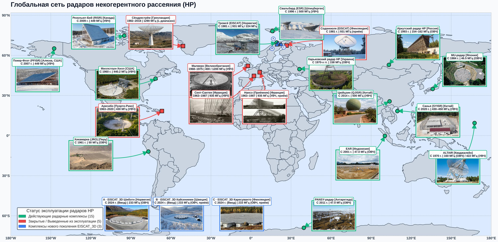

# Global Incoherent Scatter Radar (ISR) Inventory & Map Atlas

A comprehensive geospatial visualization project mapping the global distribution, technical parameters, frequency bands, and antenna architectures of **23 Incoherent Scatter Radar (ISR)** facilities around the world.

This repository features the master Python script `plot_global_isr_map.py`, high-resolution cartographic map renders with image callouts, vector SVG assets for all cataloged radar antenna systems, and `radar_svg_files.zip`.

---

## 📌 Project Overview

Incoherent Scatter Radars (ISRs) are the most powerful ground-based instruments for probing the Earth's upper atmosphere, ionosphere, and magnetosphere. This project compiles a global inventory covering:
- **Active / Operational Facilities (15 sites)**: High-power active radar systems currently conducting upper-atmosphere observations.
- **Decommissioned / Historic Facilities (5 sites)**: Legacy systems that shaped space physics history (Arecibo, Sondrestrom, Saint-Santin, Nançay, Malvern).
- **Next-Generation Facilities (3 sites)**: The state-of-the-art **EISCAT_3D** multi-static phased array network in Scandinavia (Skibotn, Kaiseniemi, Karesuvanto).

Each radar location on the global map is annotated with a **callout image box** displaying a realistic render of its specific antenna configuration connected via leader arrows to its precise geographical coordinates.

---

## 🗺️ Global ISR Map Preview

[](global_isr_radar_map_callouts.png)

*The preview is downsized for Markdown-to-PDF compatibility. Click it to open the full-resolution 1200 dpi map.*

---

## 📊 Cataloged Radar Facilities Inventory

The global catalog splits operational characteristics across three detailed parameters: **Operational Status & Years**, **Frequency Band**, and **Antenna System Type**.

| # | Facility Name | Location / Country | Coordinates | Operational Status & Timeline | Frequency Band | Antenna System Type | SVG Asset |
|:---|:---|:---|:---|:---|:---|:---|:---|
| **1** | Arecibo Observatory | Puerto Rico | 18.34° N, 66.75° W | Decommissioned (1963–2020) | UHF (430 MHz) | Fixed Spherical Reflector Dish (Ø305 m) | `Arecibo.svg` |
| **2** | Jicamarca Radio Obs. (JRO) | Peru | 11.95° S, 76.87° W | Active (Since 1961) | VHF (50 MHz) | Planar Crossed-Dipole Field Array (300×300 m) | `Jicamarca_Radar.svg` |
| **3** | Millstone Hill ISR | Massachusetts, USA | 42.62° N, 71.49° W | Active (Since 1960) | UHF (440.2 MHz) | Steerable Parabolic Dish (Ø46 m) & Zenith Dish (Ø68 m) | `Millstone_Hill.svg` |
| **4** | PFISR (Poker Flat) | Alaska, USA | 65.13° N, 147.47° W | Active (Since 2007) | UHF (449 MHz) | Active Solid-State Phased Array (128 AMISR Panels) | `PFISR_Radar.svg` |
| **5** | Resolute Bay (RISR / AMISR) | Nunavut, Canada | 74.73° N, 94.91° W | Active (Since 2009) | UHF (449 MHz) | Dual-Face Active Solid-State Phased Array (AMISR) | `AMISR_Rocket_Bay_Radar.svg` |
| **6** | Sondrestrom Radar | Greenland | 66.99° N, 50.95° W | Decommissioned (1982–2018) | L-Band / UHF (1290 MHz) | Fully Steerable Parabolic Dish (Ø32 m) | `Sondrestrom_Radar.svg` |
| **7** | Saint-Santin Transmitter | France | 44.65° N, 2.19° E | Decommissioned (1963–1987) | UHF (935 MHz) | Continuous-Wave (CW) Cassegrain Dish (Ø52 m) | `Saint_Santin_Transmitter.svg` |
| **8** | Nançay Receiver | France | 47.38° N, 6.50° E | Decommissioned (1963–1987) | UHF (935 MHz, Rx) | Parabolic Reflector Array (300×35 m) | `Nancy_Receiver.svg` |
| **9** | Malvern ISR | Worcestershire, UK | 52.11° N, 2.32° W | Decommissioned (1968–1975) | UHF (400 / 1200 MHz) | Multi-static Steerable Parabolic Dish Network | `Malvern_BW.svg` |
| **10** | EISCAT Tromsø | Norway | 69.59° N, 19.23° E | Active (Since 1981) | UHF (931 MHz) / VHF (224 MHz) | Steerable Parabolic Dish (Ø32 m) & Cylinder (120×40 m) | `EISCAT_Tromso_Radar.svg` |
| **11** | EISCAT Sodankylä | Finland | 67.36° N, 26.63° E | Active (Since 1981) | UHF (931 MHz, Rx) | Fully Steerable Parabolic Dish (Ø32 m) | `EISCAT_Sodankyla_Radar.svg` |
| **12** | EISCAT Svalbard (ESR) | Svalbard, Norway | 78.15° N, 16.03° E | Active (Since 1996) | UHF (500 MHz) | Dual Dishes (Ø31 m Steerable & Ø42 m Fixed Field-Aligned) | `EISCAT_Svalbard_Radar.svg` |
| **13** | EISCAT_3D Skibotn | Norway | 69.34° N, 20.31° E | Next-Gen (Commissioning 2024+) | VHF (233 MHz) | Active Phased Array Transceiver (~10,900 Crossed Dipoles) | `EISCAT3D_Skibotn.svg` |
| **14** | EISCAT_3D Kaiseniemi | Sweden | 68.27° N, 19.45° E | Next-Gen (Commissioning 2024+) | VHF (233 MHz, Rx) | Active Phased Array Receiver (~5,000 Crossed Dipoles) | `EISCAT3D_Kaiseniemi.svg` |
| **15** | EISCAT_3D Karesuvanto | Finland | 68.48° N, 22.52° E | Next-Gen (Commissioning 2024+) | VHF (233 MHz, Rx) | Active Phased Array Receiver (~5,000 Crossed Dipoles) | `EISCAT3D_Karesuvanto.svg` |
| **16** | Kharkiv ISR | Ukraine | 49.68° N, 36.29° E | Active (Since 1970s) | VHF (158 MHz) | Zenith Parabolic Cassegrain Dish (Ø100 m) & Steerable (Ø25 m) | `Kharkiv_Radar.svg` |
| **17** | Irkutsk ISR | Russia | 52.88° N, 103.27° E | Active (Since 1993) | VHF (154–162 MHz) | Linear Sectoral Horn Array (246×12 m) | `Irkutsk.svg` |
| **18** | MU Radar | Shigaraki, Japan | 34.85° N, 136.11° E | Active (Since 1984) | VHF (46.5 MHz) | Circular Active Phased Array (Ø103 m, 475 Yagi elements) | `MU_Radar.svg` |
| **19** | Equatorial Atmosphere Radar (EAR) | Sumatra, Indonesia | 0.20° S, 100.32° E | Active (Since 2001) | VHF (47.0 MHz) | Circular Active Phased Array (Ø110 m, 560 Yagi elements) | `EAR.svg` |
| **20** | Sanya ISR (SYISR) | Hainan, China | 18.30° N, 109.60° E | Active (Since 2020) | UHF (430–450 MHz) | Active Digital Phased Array (40×40 m, 8,320 channels) | `Sanya.svg` |
| **21** | Qujing ISR (QJISR) | Yunnan, China | 25.60° N, 103.80° E | Active (Since 2014) | UHF (500 MHz) | Fully Steerable Parabolic Dish (Ø29 m) | `Qujing.svg` |
| **22** | ALTAIR | Kwajalein Atoll | 9.40° N, 167.48° E | Active (Since 1970) | Dual VHF (160 MHz) / UHF (422 MHz) | Fully Steerable Parabolic Dish (Ø46 m) | `ALTAIR.svg` |
| **23** | PANSY Radar | Syowa, Antarctica | 69.00° S, 39.58° E | Active (Since 2011) | VHF (47.0 MHz) | Active Phased Array (1,045 Yagi Dipole elements) | `PANSY.svg` |

---

## 📁 Repository Structure

```
.
├── plot_global_isr_map.py            # Master Python script for cartographic map rendering
├── global_isr_radar_map_callouts.png   # Rendered 32x20 inch map artifact with callouts
├── global_isr_radar_map_preview.jpg    # PDF-friendly map preview
├── radar_svg_files.zip               # ZIP package containing all 23 vector SVG antenna images
└── README.md                          # Project documentation and source acknowledgments
```

---

## 🚀 Quick Start & Installation

### Requirements
- Python 3.10+
- `geopandas`
- `matplotlib`
- `pillow`
- `cairosvg`
- `numpy`
- `pyogrio`

### Setup & Execution
```bash
pip install geopandas matplotlib pillow cairosvg numpy pyogrio
python3 plot_global_isr_map.py
```

The script downloads Natural Earth country boundaries at runtime, so an internet connection is required.

---

## 🙏 Acknowledgments & Sources

### 1. Scientific Source Materials & Literature
This project relies on historical, technical, and architectural documentation provided across scientific publications and research institutes:
- **Sanya ISR (SYISR)**: Yue et al. (2024), *'The Sanya Incoherent Scatter Radar Tristatic System and Initial Experiments'*, *Space Weather*.
- **Equatorial Atmosphere Radar (EAR) & MU Radar**: Research Institute for Sustainable Humanosphere (RISH), Kyoto University, and CPEA Project records.
- **US Incoherent Scatter Radars**: MIT Lincoln Laboratory, MIT Haystack Observatory historical records (Erickson et al.), and NSF facility reports.
- **EISCAT & EISCAT_3D Facilities**: EISCAT Scientific Association technical specifications for Tromsø, Sodankylä, ESR, and EISCAT_3D (Skibotn, Kaiseniemi, Karesuvanto).
- **French & UK Historical Facilities**: Copernicus HGSS records on Saint-Santin, Nançay, and Malvern Radar History Society archives.
- **Kharkiv & Jicamarca Facilities**: Kharkiv Institute of Ionosphere & Jicamarca Radio Observatory technical publications.

### 2. Instruments & Software Tools Used
- **Gemini Notebook & Generative Image Engine**: Used for reference-grounded rendering of high-fidelity photorealistic antenna profiles based on original reference photographs.
- **CairoSVG & Pillow**: Vector SVG conversion, scaling, and composite annotation handling.
- **GeoPandas & Matplotlib**: Spatial data processing, Natural Earth map projection, and custom `AnnotationBbox` leader-arrow callout layout engine.
- **Natural Earth Data**: Low-resolution global administrative boundary dataset (`naturalearth_lowres`).

---

## 📜 License

This project is open-source under the MIT License.
